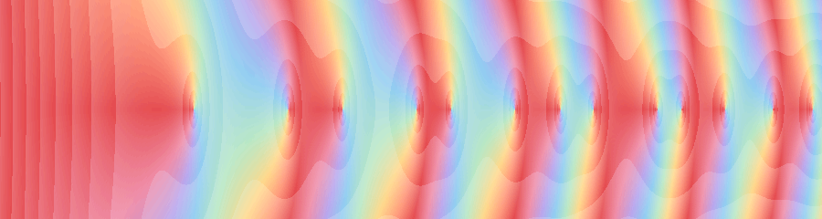
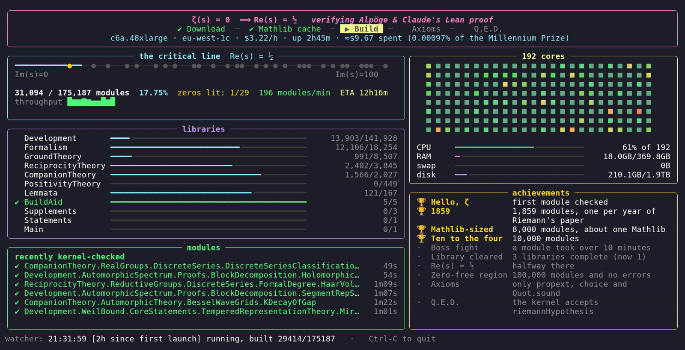

# Riemann

[](https://lean-lang.org/)
[](https://github.com/leanprover-community/mathlib4)
[](https://alpo.ge/remark.pdf)
[](#)
[](https://leanprover-community.github.io/blog/posts/riemann-hypothesis/)
[](#)
[-%3D%201%2F2%20(allegedly)-success)](#)
[](#)

[Riemann Hypothesis proof](https://alpo.ge/remark.pdf) formalized in Lean4 by Claude & Levent Alpöge.

📝 **Blog post:** [Did Claude Prove the Riemann Hypothesis? 🤔 Let's Ask a Spot Instance](https://builder.aws.com/content/3MQgDMMW6Kg6qZSjR9ozgcsogAv/did-claude-prove-the-riemann-hypothesis-lets-ask-a-spot-instance) on AWS Builder Center ([source](blog/ask-a-spot-instance.md)): what I'm running to check the formalization on AWS, and what I've learned along the way.



<sub>The completed zeta function ξ(s) over 0 ≤ Im(s) ≤ 60, colored by phase. Each pinwheel is a zero of ζ, and the picture is mirror-symmetric about the critical line Re(s) = ½, where every zero shown sits. Made with [`docs/domain_coloring.py`](docs/domain_coloring.py).</sub>

## About

On November 20th 2026, [Levent Alpöge announced a proof](https://alpo.ge/remark.pdf) of the Riemann Hypothesis found together with Claude, along with a Lean 4 formalization of the argument. The formalization is distributed as a 14-part split archive (`lean.tar.gz.part01` to `part14`) hosted at [alpo.ge](https://alpo.ge).

This repository hosts the formalization, in [`lean/`](lean). A script, `fetch_merge.sh`, fetches the parts from alpo.ge, merges them and unpacks the Lean project, so you can read it and build it yourself. The claim has not been independently verified, so check it for yourself.


<sub>The path of ζ(½ + it) for 0 ≤ t ≤ 52. Every time it passes through 0, there's a zero of ζ on the critical line. The Riemann Hypothesis says *all* the nontrivial zeros are there. Made with [`docs/zeta.py`](docs/zeta.py).</sub>

## Getting Started

### Prerequisites

- `curl`, `tar` and `gzip`
- [elan](https://github.com/leanprover/elan), the Lean toolchain manager. It installs the toolchain pinned by the project (`leanprover/lean4:v4.33.1`).
- Plenty of disk space and patience. The download is about 250 MB, and a full Mathlib-based build is heavy.

### Download and unpack

```bash
./fetch_merge.sh
```

This downloads the 14 parts into `download/parts/`, merges them into `download/lean.tar.gz`, and extracts the Lean project to `./lean`. Parts that are already downloaded are skipped, so you can re-run it safely.

### Build

```bash
cd lean
lake exe cache get   # fetch prebuilt Mathlib binaries
lake build
```

If the build finishes without errors, the formalization has been checked by Lean's kernel.

### Build in the cloud

The project has about 175,000 modules, too many for most laptops. [`verify.sh`](verify.sh) builds it from scratch on any Linux machine and checks that the main theorems use only the standard axioms (`propext`, `Classical.choice`, `Quot.sound`). The scripts in [`aws/`](aws) run it on a 192-core EC2 spot instance, and keep progress on a separate volume so the build resumes after a spot interruption:

```bash
aws/launch.sh          # launch (or resume) the instance
aws/watch.sh           # relaunch after interruptions, fetch logs and clean up when done
python3 aws/tui.py     # live dashboard
```

To correlate build progress with resource usage and cost, `aws/stats.sh` collects per-module finish and compile times, the full build log, sysstat history, CloudWatch metrics for the instance and data volume, and spot prices into `aws/results/stats/`. `aws/watch.sh` runs it every 30 minutes and before tearing anything down. `aws/analyze.py` (standard library only) joins it all into `modules.csv`, `timeseries.csv` and an HTML report:

```bash
aws/stats.sh           # snapshot statistics from the running build
python3 aws/analyze.py # write aws/results/stats/report.html
```



Stay tuned for updates and further verification of the formalization.

## References

### Primary sources

- Levent Alpöge, [*Remark*](https://alpo.ge/remark.pdf) (2026-11-20). The four-page note announcing the proof, with links to the Lean archive.
- Lean and Mathlib communities, [*Lean verification of the Riemann Hypothesis*](https://leanprover-community.github.io/blog/posts/riemann-hypothesis/) (2026-11-21). Joint statement, endorsed by the Lean FRO and the Mathlib Initiative, that certifies both the statement and the proof ([announcement on X](https://x.com/leanprover/status/2124159121645801562)).
- Levent Alpöge and Ralph Furman, [*More than two thirds of the zeta zeros are simple and on the critical line*](https://arxiv.org/abs/2608.13637) (arXiv:2608.13637). The earlier result with Claude that raised the proportion of zeros known to be on the critical line from about 41.6% to more than two thirds. See also Youness Lamzouri, [*A new proof that more than 2/3 of the zeros…*](https://arxiv.org/abs/2609.02882) (arXiv:2609.02882).

### Verification

- Andrew Sutherland (MIT), [*RH Lean proof: verification files*](https://math.mit.edu/~drew/grh/). An independent build, axiom checks and kernel replays with several independent checkers.
- [leanprover-community/riemann-hypothesis](https://github.com/leanprover-community/riemann-hypothesis). The community's Comparator setup that checks the proved theorem against Mathlib's `RiemannHypothesis`.
- Kevin Buzzard, [*"…and the proof is checked in Lean"*](https://xenaproject.wordpress.com/2026/11/12/and-the-proof-is-checked-in-lean/) (Xena Project). The four criteria the joint statement uses to judge whether a Lean proof can be trusted.
- [CocoSgt/riemann-hypothesis-lean](https://github.com/CocoSgt/riemann-hypothesis-lean). A GitHub mirror of the Lean archive, with build instructions.

### News

- Scientific American, [*Anthropic mathematician claims to prove Riemann hypothesis, most famous problem in all of math*](https://www.scientificamerican.com/article/anthropic-mathematician-claims-to-prove-riemann-hypothesis-most-famous-problem-in-all-of-math/)
- Scientific American, [*The AI Riemann hypothesis proof is true, independent mathematicians confirm*](https://www.scientificamerican.com/article/the-ai-riemann-hypothesis-proof-is-almost-certainly-true-independent-mathematicians-attest/)
- Nature, [*Mathematicians astounded by AI and human-written proofs of iconic Riemann hypothesis*](https://www.nature.com/articles/d41586-026-03812-7)
- Science, [*AI may have solved math's greatest mystery. Can humans understand the answer?*](https://www.science.org/content/article/ai-may-have-solved-math-s-greatest-mystery-can-humans-understand-answer)
- The Washington Post, [*Using Anthropic AI, mathematician claims to have solved Riemann hypothesis*](https://www.washingtonpost.com/technology/2026/11/20/using-anthropic-ai-mathematician-claims-have-solved-riemann-hypothesis/)
- Phys.org, [*Anthropic researcher says he and Claude proved the Riemann hypothesis, first posed in 1859*](https://phys.org/news/2026-11-anthropic-claude-math-greatest-riddle.html)
- SiliconANGLE, [*Anthropic researcher claims to have proven Riemann hypothesis using Claude*](https://siliconangle.com/2026/11/20/anthropic-researcher-claims-to-have-proven-riemann-hypothesis-using-claude/)
- IBM Think, [*Anthropic mathematician claims AI helped solve a 167-year-old math mystery*](https://www.ibm.com/think/news/anthropic-claude-riemann-hypothesis-math-proof)

### Guides, blogs and discussion

- [*The proof of the Riemann hypothesis announced by L. Alpöge: a guide to its architecture*](https://nasqret.github.io/riemann-rev/guide/proof-guide.pdf). An 11-page map of the proof, with links into the Lean archive ([repo and status dashboard](https://github.com/nasqret/riemann-rev)).
- Lean 4 Dev, [*The Riemann Hypothesis: a claimed proof, delivered in Lean*](https://lean4.dev/proofs/riemann-hypothesis-claim)
- DEV Community, [*A Claude-Assisted Riemann Proof Passed Lean's Compiler. That's Not the Same as Proving It*](https://dev.to/euk_ela_a3e7ed01aa3f7314e/a-claude-assisted-riemann-proof-passed-leans-compiler-thats-not-the-same-as-proving-it-2kp4)
- Hacker News, [*Levent Alpöge claims proof of the Generalized Riemann Hypothesis*](https://news.ycombinator.com/item?id=50574968)

### Videos

- Bolting, [*Inside the Alpöge–Claude Proof of the Riemann Hypothesis: a Guided Tour for Analysis Students*](https://www.youtube.com/watch?v=aKWgsUQVLYU)
- Dirac, [*Just in: An 11-page map of the claimed Riemann Hypothesis proof*](https://www.youtube.com/watch?v=YxMoQ76HgtA)
- Dirac, [*Just in: The Riemann Hypothesis Proof Passed an Independent Check*](https://www.youtube.com/watch?v=d-ANPBNcTd8)
- ThursdAI, [*Riemann solved?! Live Lean 4 verification watch*](https://www.youtube.com/watch?v=00fS-gxuBRo)
- Samuel Allen Alexander, [*The Riemann Hypothesis has been solved!! Anthropic's Levent Alpöge announces lean verified GRH!*](https://www.youtube.com/watch?v=_FrHwi9ZVtg)

### Background

- Clay Mathematics Institute, [*Riemann Hypothesis*](https://www.claymath.org/millennium/riemann-hypothesis/). The Millennium Prize problem statement.
- 3Blue1Brown, [*But what is the Riemann hypothesis? Visualizing analytic continuation*](https://www.youtube.com/watch?v=sD0NjbwqlYw)

## License

The original contents of this repository (scripts, AWS tooling, visualizations, docs and blog post) are released under the [MIT License](LICENSE).

The Lean formalization in [`lean/`](lean) is the work of Levent Alpöge and Claude, redistributed from [alpo.ge](https://alpo.ge). The MIT License does not cover it, and it remains subject to its authors' terms. Its dependency [Mathlib](https://github.com/leanprover-community/mathlib4) is licensed under Apache 2.0.
