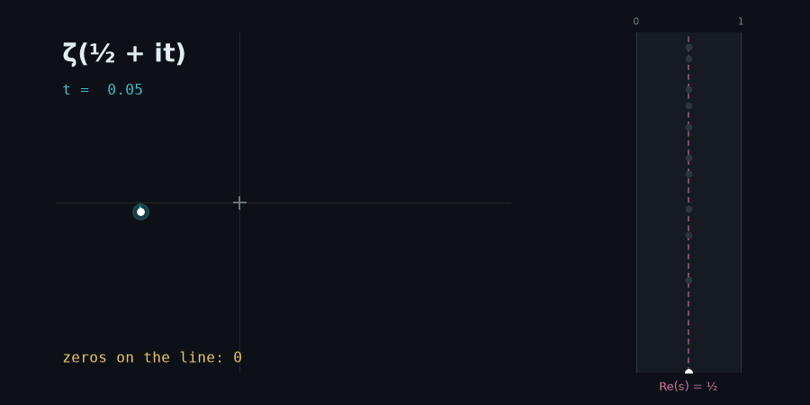

# Riemann

[](https://lean-lang.org/)
[](https://github.com/leanprover-community/mathlib4)
[](https://alpo.ge/remark.pdf)
[](#)
[](https://leanprover-community.github.io/blog/posts/riemann-hypothesis/)
[](#)
[-%3D%201%2F2%20(allegedly)-success)](#)
[](#)

[Riemann Hypothesis proof](https://alpo.ge/remark.pdf) formalized in Lean4 by Claude & Levent Alpöge.

📝 **Blog post:** [Did Claude Prove the Riemann Hypothesis? 🤔 Let's Ask a Spot Instance](https://builder.aws.com/content/3MQgDMMW6Kg6qZSjR9ozgcsogAv/did-claude-prove-the-riemann-hypothesis-lets-ask-a-spot-instance) on AWS Builder Center ([source](blog/ask-a-spot-instance.md)): what we've built so far to check the formalization on AWS, and what we learned along the way.


<sub>The completed zeta function ξ(s) over 0 ≤ Im(s) ≤ 60, colored by phase. Each pinwheel is a zero of ζ, and the picture is mirror-symmetric about the critical line Re(s) = ½, where every zero shown sits. Made with [`docs/domain_coloring.py`](docs/domain_coloring.py).</sub>

## About

On November 20th 2026, [Levent Alpöge announced a proof](https://alpo.ge/remark.pdf) of the Riemann Hypothesis found together with Claude, along with a Lean 4 formalization of the argument. The formalization is distributed as a 14-part split archive (`lean.tar.gz.part01` to `part14`) hosted at [alpo.ge](https://alpo.ge).

This repository hosts the formalization, in [`lean/`](lean). A script, `fetch_merge.sh`, fetches the parts from alpo.ge, merges them and unpacks the Lean project, so you can read it and build it yourself. The claim has not been independently verified, so check it for yourself.



<sub>The path of ζ(½ + it) for 0 ≤ t ≤ 52. Every time it passes through 0, there's a zero of ζ on the critical line. The Riemann Hypothesis says *all* the nontrivial zeros are there. Made with [`docs/zeta.py`](docs/zeta.py).</sub>

## Getting Started

### Prerequisites

- `curl`, `tar` and `gzip`
- [elan](https://github.com/leanprover/elan), the Lean toolchain manager. It installs the toolchain pinned by the project (`leanprover/lean4:v4.33.1`).
- Plenty of disk space and patience. The download is about 250 MB, and a full Mathlib-based build is heavy.

### Download and unpack

```bash
./fetch_merge.sh
```

This downloads the 14 parts into `download/parts/`, merges them into `download/lean.tar.gz`, and extracts the Lean project to `./lean`. Parts that are already downloaded are skipped, so you can re-run it safely.

### Build

```bash
cd lean
lake exe cache get   # fetch prebuilt Mathlib binaries
lake build
```

If the build finishes without errors, the formalization has been checked by Lean's kernel.

### Build in the cloud

The project has about 175,000 modules, too many for most laptops. [`verify.sh`](verify.sh) builds it from scratch on any Linux machine and checks that the main theorems use only the standard axioms (`propext`, `Classical.choice`, `Quot.sound`). The scripts in [`aws/`](aws) run it on a 192-core EC2 spot instance, and keep progress on a separate volume so the build resumes after a spot interruption:

```bash
aws/launch.sh          # launch (or resume) the instance
aws/watch.sh           # relaunch after interruptions, fetch logs and clean up when done
python3 aws/tui.py     # live dashboard
```

To correlate build progress with resource usage and cost, `aws/stats.sh` collects per-module finish and compile times, the full build log, sysstat history, CloudWatch metrics for the instance and data volume, and spot prices into `aws/results/stats/`. `aws/watch.sh` runs it every 30 minutes and before tearing anything down. `aws/analyze.py` (standard library only) joins it all into `modules.csv`, `timeseries.csv` and an HTML report:

```bash
aws/stats.sh           # snapshot statistics from the running build
python3 aws/analyze.py # write aws/results/stats/report.html
```


Stay tuned for updates and further verification of the formalization.
