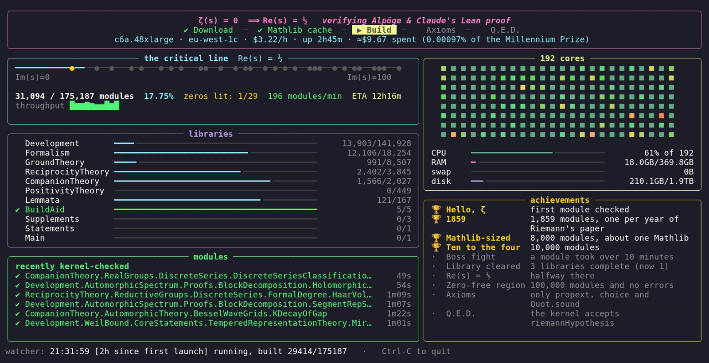

# Did Claude Prove the Riemann Hypothesis? 🤔 Let's Ask a Spot Instance

> I built all 175,187 project modules of a claimed Lean 4 proof of the Riemann Hypothesis on EC2 Spot in 21 hours and 19 minutes. Here's what passed, what it cost, and what my run didn't check.

> **Update (22 November 2026):** The build and axiom audit finished successfully. I've published the [verification report](https://jgalego.github.io/riemann/) and the [logs, scripts and checksums](https://github.com/JGalego/riemann/releases/tag/verification-2026-11-22). The source code is on [GitHub](https://github.com/JGalego/riemann).

The first time I read about the Riemann Hypothesis (RH) was in Thomas Pynchon's novel *Against the Day*, which I highly recommend. In the novel, RH symbolizes the hidden structure connecting reality and possibility, suggesting that beneath the apparent chaos of existence lies an underlying order. In fact, the connection between RH and chaos is not just metaphorical, since the [statistical behaviour of Riemann zeros is mathematically linked to quantum chaos and random matrix theory](https://michaelberryphysics.wordpress.com/wp-content/uploads/2013/07/berry401.pdf), although the deeper physical relationship and its significance remains within the realm of conjecture.

The fascination with the story led me to borrow another book, the first one I'd take from the college library: [Titchmarsh's *The Theory of the Riemann Zeta-Function*](https://sites.math.rutgers.edu/~zeilberg/EM18/TitchmarshZeta.pdf), which I devoured in a couple of weeks. Or perhaps it was Mike & Ike's *Quantum Computation and Quantum Information*. For the purposes of this story, I'm going with Titchmarsh.

The important thing is that RH has been lurking in the background ever since. So when [Levent Alpöge announced a proof](https://alpo.ge/remark.pdf), found together with Claude and accompanied by a Lean 4 formalization, I couldn't resist trying to check it independently.

The idea is simple: let Lean's kernel check the formal proof. The catch is the size: **175,187 Lean modules**, roughly 21 times as many as Mathlib. My local setup couldn't handle that, so I took the build to AWS.

## ✅ What I ran

I use [`verify.sh`](https://github.com/JGalego/riemann/blob/main/verify.sh) to install Lean, download the 14-part archive, fetch the Mathlib cache, and run `lake build` with retries. For the AWS run, I pin the archive's expected SHA-256. After the build, the script runs `#print axioms` on five main theorems and fails if they depend on anything beyond `propext`, `Classical.choice`, and `Quot.sound`.

- **Spot capacity.** I use [`launch.sh`](https://github.com/JGalego/riemann/blob/main/aws/launch.sh) to rank five 192-vCPU instance types (c7a, c6a, c7i, m6a, m7a) across Availability Zones by quoted Spot price per vCPU. It filters out quotes above $4/h and tries candidates in price order until one has capacity.
- **Interruptions.** I keep the sources, Mathlib, and build outputs on a separate 2 TB gp3 EBS volume. On a two-minute Spot interruption notice, the instance stops the build and flushes the disk. [`watch.sh`](https://github.com/JGalego/riemann/blob/main/aws/watch.sh) launches a replacement in the same AZ and reattaches the volume; Lake reuses the finished modules.
- **Time budget and cleanup.** I've set a 36-hour budget measured from the first launch, with instance shutdown timers as a backstop. On success, the watcher fetches the logs, terminates the instance, and deletes the data volume by default. On failure, it keeps the volume for inspection. That volume costs about $0.29/h even without a running instance.

## 📊 The result

The timed build ran from **21 November 2026 at 19:07 UTC to 22 November at 16:26 UTC** on a `c6a.48xlarge` Spot instance in `eu-west-1c`: 192 vCPUs, 384 GiB of RAM, and **$3.19–3.22/h for compute**. There were no Spot interruptions during the build.

| Measure | Result |
|---|---|
| Project modules built | 175,187 |
| Build errors | 0 |
| Warnings | 460,321 |
| Build wall time | 21 h 19 m (76,763 seconds) |
| Summed module compile time | 4,009.2 hours |
| Sampled memory peak | 33.1 GB |
| Build directory | 1.2 TB, including 94.6 GB of `.olean` files |

The compile-time total adds each module's elapsed compilation time, not measured CPU usage. It is much larger than wall time because modules build in parallel. The warnings are mostly linter suggestions; the full [build log](https://github.com/JGalego/riemann/releases/download/verification-2026-11-22/build.log.gz) is available for inspection.

The published metrics estimate **$80.57 for Spot compute and the 2 TB data volume through the 22 November, 18:09 UTC snapshot**. That includes setup and time after the build finished, not just compilation. It isn't a final AWS bill: root-volume charges and costs outside that recorded window aren't included. The [resource and cost report](https://github.com/JGalego/riemann/releases/download/verification-2026-11-22/report.html) and [five-minute data](https://github.com/JGalego/riemann/releases/download/verification-2026-11-22/timeseries.csv) show how the estimate was made.

I used a terminal dashboard to watch the build:



### The axiom audit

After `lake build` exited successfully, my script ran `#print axioms` on the five main theorems. The [output](https://github.com/JGalego/riemann/releases/download/verification-2026-11-22/axioms.log) was:

```text
'riemannHypothesis' depends on axioms: [propext, Classical.choice, Quot.sound]
'riemannZeta_eq_zero_re' depends on axioms: [propext, Classical.choice, Quot.sound]
'LFunction_ne_zero_of_half_lt_re' depends on axioms: [propext, Classical.choice, Quot.sound]
'LFunction_eq_zero_re' depends on axioms: [propext, Classical.choice, Quot.sound]
'LFunction_eq_zero_re_of_isPrimitive' depends on axioms: [propext, Classical.choice, Quot.sound]
```

All five depend only on Lean's standard axioms. None of these proofs depends on `sorryAx` or an added axiom, and [`verify.sh`](https://github.com/JGalego/riemann/blob/main/verify.sh) wrote a final status of `ok`.

For RH itself, [`Main.lean`](https://github.com/JGalego/riemann/blob/main/lean/src/Main.lean#L4) proves Mathlib's existing [`RiemannHypothesis`](https://leanprover-community.github.io/mathlib4_docs/Mathlib/NumberTheory/LSeries/RiemannZeta.html#RiemannHypothesis), rather than introducing a local definition. I checked that by inspecting the source; I didn't run an automated theorem-comparison check. The L-function results cover Dirichlet L-functions, not the generalized hypothesis for all number-field or automorphic L-functions.

## 💡 Lessons learned

1. **Size the disk from a trial run.** A short run produced about 7 MB of build output per module. Across 175,187 modules, that's roughly 1.2 TB, so I chose a 2 TB volume.
2. **Raise the open-file limit.** Hundreds of parallel Lean processes exhausted the default per-process file-descriptor limit. In [`verify.sh`](https://github.com/JGalego/riemann/blob/main/verify.sh), I use:

   ```bash
   ulimit -n 1048576
   ```

   If that fails, the script falls back to the current hard limit with `ulimit -n "$(ulimit -Hn)"`. The build runs as a transient systemd service, so I also set its limit explicitly:

   ```bash
   systemd-run --unit=riemann-verify -p LimitNOFILE=1048576 /opt/run.sh
   ```

3. **Don't pin one instance type.** Spot capacity for 192-vCPU machines varies by type and AZ. I try a ranked list of alternatives rather than waiting for one specific type to become available.
4. **Create the volume after the instance.** EBS volumes are tied to one AZ. I wait until I know where the instance landed before creating the volume there. I also locate the disk by size rather than relying on an NVMe device name.
5. **Check the Spot vCPU quota first.** The default quota can be lower than one large instance needs. My launch script checks it before trying to launch.
6. **"It compiles" isn't "it's proven".** A `sorry` or custom axiom can compile too. My script handles the axiom audit, but it doesn't compare the theorem statement with Mathlib's accepted definition. Source inspection, an automated statement comparison, and independent kernel replay are different checks; I shouldn't report one as another.

## 📡 What's next

My run built the project's own modules from source, but **Mathlib came from its prebuilt cache**. I used Lean's standard kernel; I didn't replay exported proof terms with independent checkers or run the community's [Comparator setup](https://github.com/leanprover-community/riemann-hypothesis).

The run also used **two instances**, not one uninterrupted launch. The first stopped on an open-file limit while fetching the Mathlib cache, after checking the archive hash. Its log was lost. I resumed from the same data volume on the instance whose build and axiom logs are published, and recomputed the archive hash from a separate download. That gap is documented in the [release notes](https://github.com/JGalego/riemann/releases/tag/verification-2026-11-22).

I'm not claiming RH has been proved on the strength of my run. A clean build and axiom audit are evidence about this formalization, not a substitute for mathematical scrutiny.

**Update (21 November 2026):** The Lean and Mathlib communities have published a [joint statement](https://leanprover-community.github.io/blog/posts/riemann-hypothesis/), endorsed by the Lean FRO and the Mathlib Initiative, saying they have "full confidence that Alpöge's proof of the Riemann Hypothesis is correct". They report comparing the proved theorem with Mathlib's RH statement and checking the exported proof with several independent proof checkers. That's broader evidence than my build alone can provide.

The next verification steps are an automated statement comparison and independent kernel replay. A human-readable mathematical write-up is still pending; compiling 175,187 modules doesn't produce one.
